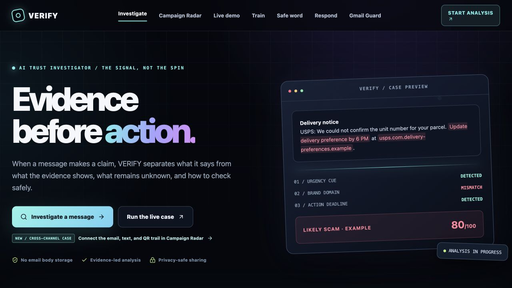
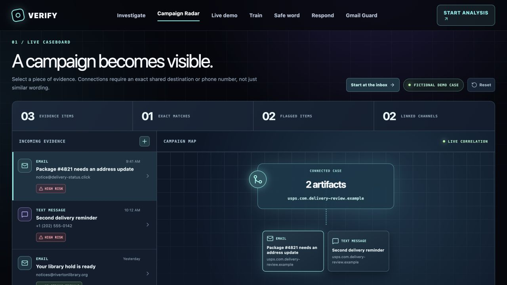
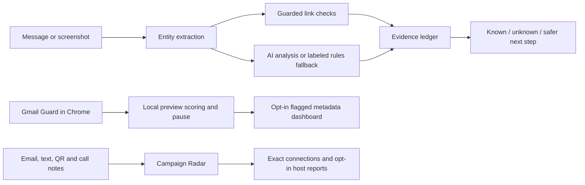

<div align="center">

# VERIFY

### Evidence before action.

**A suspicious message makes a claim. VERIFY shows what the evidence supports, what remains unknown, and the safest way to check.**

[Live app](https://verify-scam-investigator.randomdude15.chatgpt.site/) · [90-second guided case](https://verify-scam-investigator.randomdude15.chatgpt.site/demo) · [Campaign Radar](https://verify-scam-investigator.randomdude15.chatgpt.site/radar)

</div>



## Why VERIFY exists

Warnings are easy to dismiss when they arrive without an explanation. A message says *“your package is delayed”* or *“your account is at risk.”* A red badge says *“suspicious.”* The person still has to decide whether to click, pay, reply, or ignore it.

VERIFY makes that decision more informed. It turns a warning into an inspectable case:

> **The message claims:** a delivery problem needs immediate payment.
>
> **The evidence shows:** the link leads outside the claimed carrier's domain and the request adds a deadline.
>
> **We still don't know:** whether there is a real package issue or who sent the message.
>
> **The safer route:** open the carrier's official site yourself; never use the message link to verify it.

The AI helps organize and explain evidence. It does **not** authenticate a sender, prove fraud, or decide for the user.

## See it work

1. **[Run the guided case](https://verify-scam-investigator.randomdude15.chatgpt.site/demo).** Open a fictional delivery email, inspect its evidence, and experience the reversible pause before following a risky link.
2. **[Investigate a message](https://verify-scam-investigator.randomdude15.chatgpt.site/#workspace).** Paste text or add a screenshot. VERIFY extracts observable signals, checks link cues, and builds a claim-and-evidence ledger.
3. **[Open Campaign Radar](https://verify-scam-investigator.randomdude15.chatgpt.site/radar).** Trace exact shared destinations across email, text, and QR evidence. Add your own evidence to view opt-in community report counts for a real hostname.



## What is built

| Surface | What it does |
| --- | --- |
| **Investigation desk** | Streams entity extraction, guarded link analysis, an AI assessment, exact source quotes, and a clear *known / unknown / next step* ledger. Falls back to labeled rules-based analysis when the AI provider is unavailable. |
| **Evidence dossier** | Shows an annotated message, a five-signal pattern fingerprint, link findings, and a hypothetical next move. Deep redirect tracing is opt-in. |
| **Gmail Guard** | A Chrome Manifest V3 extension checks visible Gmail previews locally, pauses high-risk emails and links, and lets a user explicitly continue. Paired browsers can sync flagged metadata to a dashboard. |
| **Background inbox demo** | An optional personal Google Apps Script can check recent Gmail messages roughly every five minutes while the browser is closed, after the account owner authorizes read-only Gmail access. |
| **Campaign Radar** | Connects artifacts by an exact hostname or phone number. Signed-in users can submit or withdraw a hostname report; counts are labeled **unverified community submissions**, never invented sample data. |
| **Training, family safe word, response plan** | Practice on fictional messages, agree on a private callback phrase, and get prioritized steps after a click, payment, or reply. |
| **USPS adapter** | Can query the official USPS Tracking API when developer credentials are configured. A tracking record does not validate the email sender or a payment request. The public demo currently has no USPS credentials. |

The [Chrome extension](extension/) and [personal background sync kit](integrations/apps-script/) are source available here. They are **not** published to the Chrome Web Store or connected to a visitor's Gmail by default.

## How the system works



- **Frontend:** React, TypeScript, Vinext, responsive CSS, Lucide icons.
- **Runtime:** Cloudflare Workers through OpenAI Sites; D1 stores paired devices, flagged alert metadata, and opt-in community reports.
- **AI:** NVIDIA NIM for structured investigations and training. Evidence checks validate quotes against the submitted text; unavailable AI results are clearly labeled.
- **Link safety:** URL validation rejects private or local addresses, credentials, unusual ports, and unsafe schemes. Passive inspection is the default; deep redirect tracing requires a separate choice.
- **Privacy:** Investigation text and screenshots are not intentionally saved in VERIFY's product database. Submissions to the AI service and optional link checks still leave the browser. See the [public privacy policy](https://verify-scam-investigator.randomdude15.chatgpt.site/privacy).

## Run locally

Requires **Node.js 22.13+** and npm.

```bash
git clone https://github.com/Nithin-Manikandan/VERIFY.git
cd VERIFY
npm ci
cp .dev.vars.example .dev.vars
npm run dev
```

Open the local URL printed by Vite. The app works in a **rules-only mode** without an NVIDIA key. Add your own key to the ignored `.dev.vars` file to enable AI analysis. Never commit that file.

The public [live app](https://verify-scam-investigator.randomdude15.chatgpt.site/) includes the hosted dashboard and community storage. Local account features need a D1 database and migrations; the investigator, fictional demo, training fallback, and browser-local tools can be explored without a connected account. Production secrets belong in the hosting environment, not in Git.

```bash
npm test
npm run lint
npx tsc --noEmit
npm run build
```

The test suite covers evidence grounding, safe URL handling, prompt-injection resistance, the Gmail preview scorer, campaign matching, background-sync rules, and the USPS adapter with mocked responses. The [demo script](docs/DEMO.md) walks through the core story.

## Honest limits

- A score is an assessment of visible warning signs, **not** a probability of fraud or proof of safety.
- Pasted text cannot authenticate an email sender. A missing community report does not mean a destination is safe.
- Live bank or marketplace account status is not connected. The USPS API check requires credentials and a real tracking number.
- Background Gmail sync is an optional personal setup, not a turnkey public OAuth integration; Google timer and quota limits apply.
- In-memory API rate limits are suitable for a hackathon demo, not a production abuse-control system.

**VERIFY's promise is simple: show the evidence, admit what is unknown, and give people a safer next action.**
